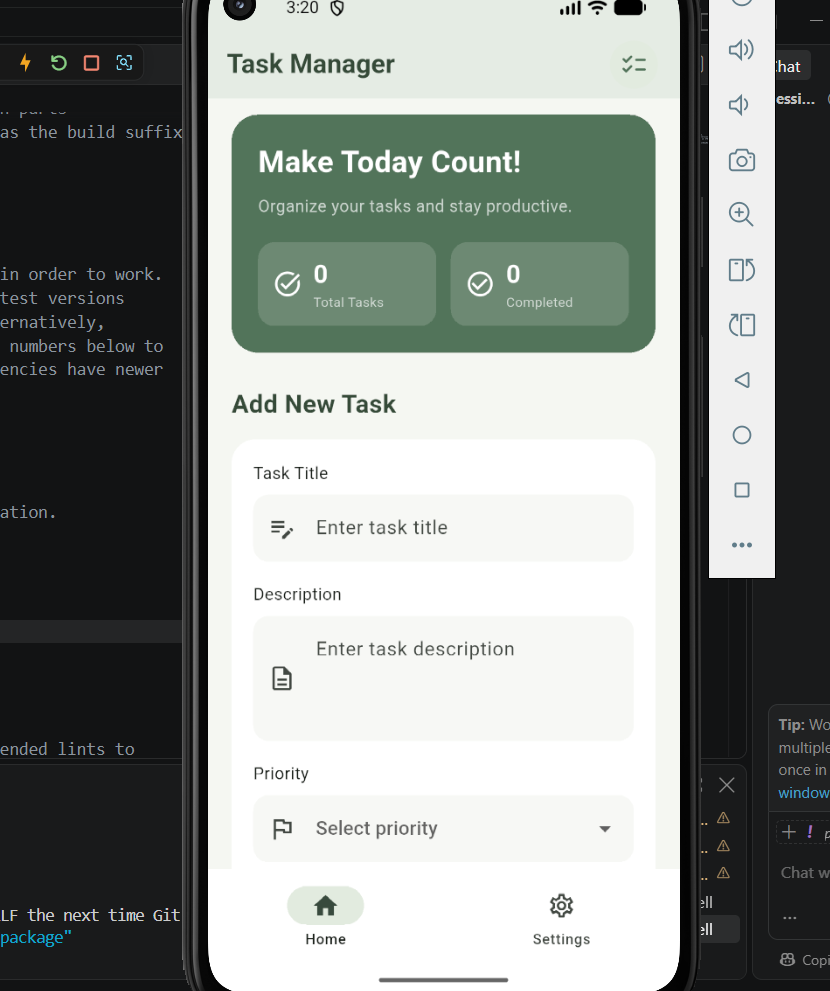

# Task Manager App

A simple and user-friendly Flutter application that helps users organize and manage their daily tasks.

## Features

- Add new tasks with a title and description.
- Set task priorities.
- Mark tasks as completed.
- Delete tasks.
- Save tasks locally using SharedPreferences.
- Restore saved tasks when reopening the application.
- Navigate between Home and Settings screens.

## Screenshots

### Home Screen



### Saved Tasks

The application saves tasks locally and keeps them available even after closing and reopening the app.


## Package Used

**Package:** [shared_preferences](https://pub.dev/packages/shared_preferences)

**Why was it chosen?**

SharedPreferences was selected to store task data locally on the device. It allows users to keep their tasks saved and retrieve them when they reopen the application without needing an internet connection or a database server.

## Technologies Used

- Flutter
- Dart
- SharedPreferences

## Installation and Usage

1. Clone the repository.
2. Open the project in VS Code.
3. Run the following command:

```bash
flutter pub get
flutter run
